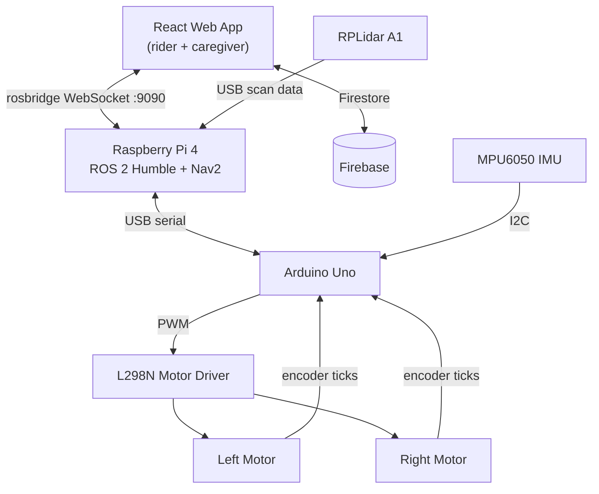

# ♿ ROS 2 Autonomous Smart Wheelchair

<div align="center">
  
  <p><i>The assembled, custom-built autonomous wheelchair platform.</i></p>
</div>

An assistive-technology prototype that drives itself from room to room. It runs **ROS 2 Humble** on a **Raspberry Pi 4** with a **2D LiDAR**, navigates with **Nav2**, and detects falls and collisions with an IMU. A **React web dashboard** lets the rider send the chair to saved places with their voice, while caregivers track it remotely and receive emergency alerts.


---

## ✨ Key Features

- **Autonomous navigation**: map-based path planning and obstacle avoidance with the ROS 2 **Nav2** stack, localized on a pre-built 2D map
- **2D SLAM mapping**: build floor maps in real time with **slam_toolbox** and the RPLidar A1
- **Voice control**: say *"Go to Kitchen"* from a phone using the browser's Web Speech API
- **Caregiver dashboard**: live position, navigation status, and arrival alerts, synced through Firebase
- **Fall and collision detection**: an MPU6050 IMU feeds a ROS 2 node that flags tip-overs, free-fall, and impact spikes, then logs alerts for caregivers
- **Closed-loop motor control**: Arduino firmware runs PID velocity control from wheel encoders and talks to ROS 2 over serial
- **Simulation support**: Gazebo worlds and a URDF model for testing without hardware

## 🎥 Demos

<div align="center">
  <h3>🗺️ 1. SLAM map-making</h3>
  <p>The spinning LiDAR scans the room and builds a 2D occupancy-grid map in real time.</p>

  https://github.com/user-attachments/assets/3d9d18e0-bff8-453b-9cfe-c8f5d518db99

  <h3>🤖 2. Autonomous navigation</h3>
  <p>Path planning, dynamic obstacle avoidance, and goal completion with Nav2.</p>

  https://github.com/user-attachments/assets/6eddb357-4569-4883-a333-2ce82ca87bde
</div>

---

## 🧠 Why 2D LiDAR instead of camera-only SLAM?

Dense visual SLAM at 30 FPS needs a GPU-class board such as a Jetson Orin. Running it next to the Nav2 stack on a Raspberry Pi 4 would saturate the CPU and add heavy latency. The RPLidar A1 does the range measurement on its own hardware and sends lightweight scan arrays over USB, so the Pi can map and navigate with low compute overhead.

## 🏗️ System Architecture



### Key ROS 2 topics

| Topic | Type | Purpose |
| --- | --- | --- |
| `/cmd_vel` | `geometry_msgs/Twist` | Velocity commands from Nav2 to the Arduino bridge |
| `/odom_raw` | `nav_msgs/Odometry` | Wheel odometry, also used by the dashboard to detect arrival |
| `/imu_raw` | `sensor_msgs/Imu` | MPU6050 data from the Arduino |
| `/scan` | `sensor_msgs/LaserScan` | RPLidar A1 scan data |
| `/goal_pose` | `geometry_msgs/PoseStamped` | Navigation goals published by the web app |
| `/emergency_alerts` | `std_msgs/String` | Fall and collision alerts from `imu_fall_detector.py` |

---

## 🛠️ Hardware

| Component | Voltage | Notes |
| :--- | :--- | :--- |
| **JGA25-370 motors (×2)** | 12 V DC | 11 PPR encoder, 21.3:1 gearbox, 280 RPM |
| **Raspberry Pi 4B** | 5 V / 3 A | 4 GB RAM, runs ROS 2 Humble |
| **Arduino Uno R3** | USB powered | Motor control, PID, encoder reading, IMU |
| **L298N motor driver** | 12 V supply | Dual H-bridge, up to 2 A per motor |
| **RPLidar A1** | 5 V | 360° scanner over USB |
| **MPU6050 IMU** | 3.3 V | Gyro + accelerometer for fall detection |
| **3 × 18650 cells** | 11.1 V (3S) | Motor power |
| **5 V / 3 A power bank** | 5 V | Powers the Raspberry Pi |

### Wiring

> ⚠️ **All grounds must be joined**: connect the battery, motor driver, and Arduino grounds together.

<details>
<summary><b>L298N → Arduino Uno</b></summary>

| L298N pin | Arduino pin | Description |
| --- | --- | --- |
| ENA | 6 | Left motor PWM *(remove jumper)* |
| IN1 | 7 | Left motor direction 1 |
| IN2 | 8 | Left motor direction 2 |
| ENB | 11 | Right motor PWM *(remove jumper)* |
| IN3 | 12 | Right motor direction 1 |
| IN4 | 13 | Right motor direction 2 |

</details>

<details>
<summary><b>Motors and encoders</b></summary>

| Motor wire | Right motor | Left motor |
| --- | --- | --- |
| Red (power) | L298N OUT3 | L298N OUT1 |
| White (power) | L298N OUT4 | L298N OUT2 |
| Yellow (encoder C1) | Arduino 3 | Arduino 2 |
| Green (encoder C2) | Arduino 5 | Arduino 4 |
| Blue (encoder VCC) | 5 V | 5 V |
| Black (encoder GND) | GND | GND |

</details>

<details>
<summary><b>MPU6050 → Arduino, and power distribution</b></summary>

| MPU6050 | Arduino | Description |
| --- | --- | --- |
| VCC | 3.3V | Power |
| GND | GND | Ground |
| SDA | A4 | I²C data |
| SCL | A5 | I²C clock |

| Source | Target | Connection |
| --- | --- | --- |
| 3S 18650 battery (11.1 V) | L298N 12 V + GND | Direct wires |
| 5 V / 3 A power bank | Raspberry Pi 4 | USB-C |
| Raspberry Pi 4 | Arduino Uno | USB (data + 5 V) |
| Raspberry Pi 4 | RPLidar A1 | Micro-USB (data + 5 V) |

</details>

---

## 📁 Repository Structure

```text
.
├── assets/               # Photos, screenshots, and demo videos
├── firmware/
│   ├── arduino_bridge/   # Arduino firmware: PID motor control, encoders, IMU, serial protocol
│   └── calibration/      # IMU calibration sketch
├── hardware_test/        # Open-loop sketch to verify motor wiring and encoder direction
├── lidarbot_ws/          # ROS 2 workspace
│   └── src/
│       ├── lidarbot/     # Robot packages: bringup, description, slam, navigation,
│       │                 #   teleop, aruco, gazebo, gz
│       └── rplidar_ros/  # Slamtec RPLidar driver
├── scripts/              # Pi helpers: file sync, performance monitor, local LLM benchmark
└── web_app/              # React + Firebase dashboard (rider and caregiver)
```

---

## 🚀 Getting Started

### 1. Flash the Arduino

1. Install the **Adafruit MPU6050** library in the Arduino IDE.
2. Open `firmware/arduino_bridge/arduino_bridge.ino`, select **Arduino Uno** and your port, then upload.
3. *(Optional)* Use `hardware_test/hardware_test.ino` first to check motor wiring and encoder directions, and `firmware/calibration/calibration.ino` to tune IMU thresholds.

### 2. Set up the Raspberry Pi

1. Install **Ubuntu 22.04** and **ROS 2 Humble**.
2. Install the extra ROS dependencies:

   ```bash
   sudo apt install ros-humble-navigation2 ros-humble-nav2-bringup \
     ros-humble-slam-toolbox ros-humble-robot-localization \
     ros-humble-rosbridge-suite ros-humble-xacro python3-serial
   ```

3. Clone and build the workspace:

   ```bash
   git clone https://github.com/<your-username>/ROS2-Autonomous-Wheelchair.git
   cd ROS2-Autonomous-Wheelchair/lidarbot_ws
   rosdep install --from-paths src --ignore-src -y
   colcon build --symlink-install
   source install/setup.bash
   ```

4. **Create udev symlinks.** The launch files expect stable device names: `/dev/ttyUSB_LIDAR` for the RPLidar and `/dev/ttyUSB_ARDUINO` for the Arduino. See `lidarbot_ws/src/rplidar_ros/scripts/` for an RPLidar udev rule to adapt, and add a similar rule for your Arduino.

### 3. Run the robot

```bash
# Robot model, LiDAR, and Arduino bridge (publishes /odom_raw, /imu_raw, TF)
ros2 launch lidarbot_bringup real_robot.launch.py

# Fall and collision detector (publishes /emergency_alerts)
python3 lidarbot_ws/src/lidarbot/lidarbot_bringup/script/imu_fall_detector.py

# WebSocket bridge for the web app
ros2 launch rosbridge_server rosbridge_websocket_launch.xml
```

**Build a map** (drive manually, then save):

```bash
ros2 launch lidarbot_slam online_async_launch.py
ros2 run nav2_map_server map_saver_cli -f ~/my_home_map
```

**Navigate autonomously** on a saved map:

```bash
ros2 launch lidarbot_navigation nav2_real.launch.py map:=$HOME/my_home_map.yaml
```

A pre-built example map is included in `lidarbot_navigation/maps/`.

### 4. Run the web dashboard

```bash
cd web_app
cp .env.example .env     # add your Firebase project keys
npm install
npm run dev
```

- The dev server uses HTTPS (`@vitejs/plugin-basic-ssl`) because mobile browsers block the microphone on plain HTTP.
- The default rosbridge address is hard-coded in `web_app/src/App.jsx` (`ws://192.168.100.129:9090`). Change it to your Pi's IP.
- Firestore collections used: `accounts`, `locations`, `alerts`, `state`.

<div align="center">
  <table>
    <tr>
      <td align="center" width="50%">
        <b>Caregiver telemetry hub</b><br><br>
        
        <p><small>Live position, navigation status, and arrival alerts.</small></p>
      </td>
      <td align="center" width="50%">
        <b>Voice command panel</b><br><br>
        
        <p><small>Hands-free commands such as "Go to Kitchen".</small></p>
      </td>
    </tr>
  </table>
  <b>Emergency event log</b><br><br>
  
  <p><small>Tip-over and collision alerts, with a 3-second write throttle.</small></p>
</div>

### 5. Save destinations

Open the map in **Foxglove Studio** (or RViz) over `ws://<PI_IP>:9090`, subscribe to `/map`, `/scan`, and `/tf`, and read the X/Y coordinates of a spot. A caregiver enters them in the web app to save a named destination such as "Kitchen".

---

## 🧗 Challenges Solved

- **Microphone on mobile**: Mobile Chrome blocks the Web Speech API on non-HTTPS origins. The Vite dev server runs over HTTPS and a custom `wss://` proxy tunnels the unencrypted ROS WebSocket.
- **Duplicate alerts**: With several dashboards open, one ROS alert caused several Firestore writes. Using deterministic `setDoc` document IDs plus a 3-second cooldown fixed it.
- **Low-latency arrival detection**: The UI subscribes to `nav_msgs/Odometry` and computes the Euclidean distance to the goal, instead of parsing slower navigation logs.

## ⚠️ Safety and Security Notes

This is a research and learning prototype. **It is not a certified medical device and must not be used to transport a person unsupervised.**

- Keep the chair under human supervision and add a hardware emergency stop before any rider test.
- The web app's login is a demo: accounts are stored in Firestore and checked in the browser. Replace this with **Firebase Authentication** and Firestore security rules before any real deployment, and change the seeded default accounts.

## 🚧 Limitations and Future Work

- **2D only**: The LiDAR scans one plane, so it can miss overhanging tables or objects on the floor. Planned: a Jetson-class computer plus a depth camera for 3D obstacle avoidance.
- Experimental scripts in `scripts/` benchmark small local LLMs (via Ollama) on the Pi for natural-language destination commands. They are not integrated yet.

## 🙏 Acknowledgments

- Robot packages are adapted from the open-source [**lidarbot**](https://github.com/TheNoobInventor/lidarbot) project by Chinedu Amadi (BSD 3-Clause, see `lidarbot_ws/src/lidarbot/LICENSE`).
- [`rplidar_ros`](https://github.com/Slamtec/rplidar_ros) by Slamtec.
- [Nav2](https://nav2.org/), [slam_toolbox](https://github.com/SteveMacenski/slam_toolbox), and [rosbridge](https://github.com/RobotWebTools/rosbridge_suite).

## 📄 License

Third-party packages keep their original licenses. No license has been chosen yet for the original code in this repository. Add a `LICENSE` file (for example MIT) to define how others may reuse it.
